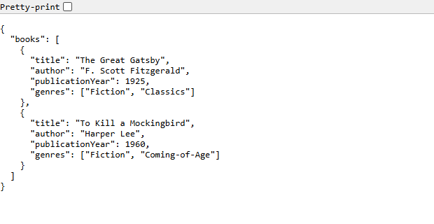
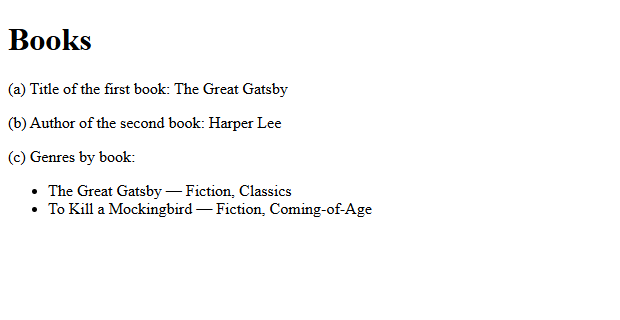
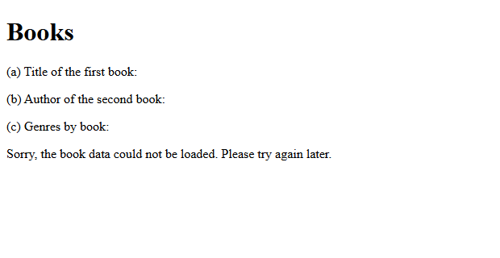
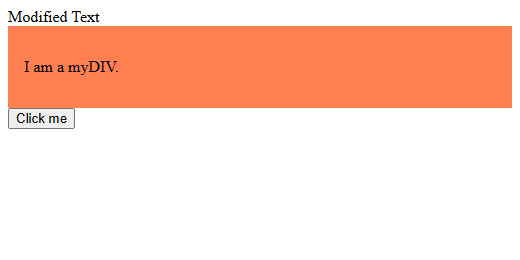
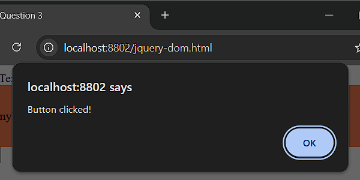

# Lab 4b - Client-Side Scripting (JSON and jQuery)

**Name:** Edmund Lim Zee Enn
**Student ID:** AI250274
**Course:** BIC21203 Web Development

This lab covers making a JSON file, loading it with `fetch()`, and rewriting some plain JavaScript DOM code with jQuery.

## Files

| Question | Files | What it does |
| --- | --- | --- |
| Q1 | `books.json` | Two books in a `books` array (title, author, publicationYear, genres) |
| Q2 | `books.html`, `books.js` | Loads `books.json` with `fetch()` and shows the data on the page |
| Q3 | `jquery-dom.html`, `jquery-dom.js` | Uses jQuery 4.0.0 to change text, add a class and handle a click |

## How to run

`fetch()` doesn't work when the page is opened as a `file://` path, so Q2 has to be run through a local server.

**Option 1: VS Code Live Server**
Open the folder in VS Code, right-click `books.html` and choose "Open with Live Server".

**Option 2: Python**
```
python -m http.server 8000
```
Then go to `http://localhost:8000/books.html` and `http://localhost:8000/jquery-dom.html`.

Q3 loads jQuery from the CDN, so it needs internet.

## Notes

- **Q1:** `publicationYear` is a number and `genres` is an array of strings. Checked with `JSON.parse()` and it parses without errors.
- **Q2:** `loadBooks()` uses `async/await`. If the response isn't OK (e.g. 404) or the JSON is broken, the `catch` block shows "Sorry, the book data could not be loaded. Please try again later." on the page. All text is added with `textContent` and `createElement()`.
- **Q3:**

| | Native JavaScript | jQuery |
| --- | --- | --- |
| (a) | `document.getElementById("myElement").textContent = "Modified Text";` | `$("#myElement").text("Modified Text");` |
| (b) | `document.querySelector("#myDIV").classList.add("myStyle");` | `$("#myDIV").addClass("myStyle");` |
| (c) | `document.getElementById("myButton").addEventListener("click", () => alert("Button clicked!"));` | `$("#myButton").on("click", () => alert("Button clicked!"));` |

Advantage of native JavaScript: it's built into the browser, so there's no extra library to download and the page loads faster.
When jQuery is still used: older projects (like WordPress sites or old admin panels) that were built with jQuery and its plugins, where rewriting everything isn't worth it.

## Screenshots

### Q1 - books.json



### Q2 - books.html



Error message when `books.json` can't be loaded:



### Q3 - jquery-dom.html

After (a) and (b) run on page load:



After clicking "Click me":



## Reflection

Making the JSON file showed me how strict the format is, since things like trailing commas or single quotes break it. Using `fetch()` taught me that it needs a local server and that I should handle errors so the user sees a proper message instead of a blank page. Rewriting the native code in jQuery showed that jQuery is shorter to write, but plain JavaScript can do the same things now without an extra library.
